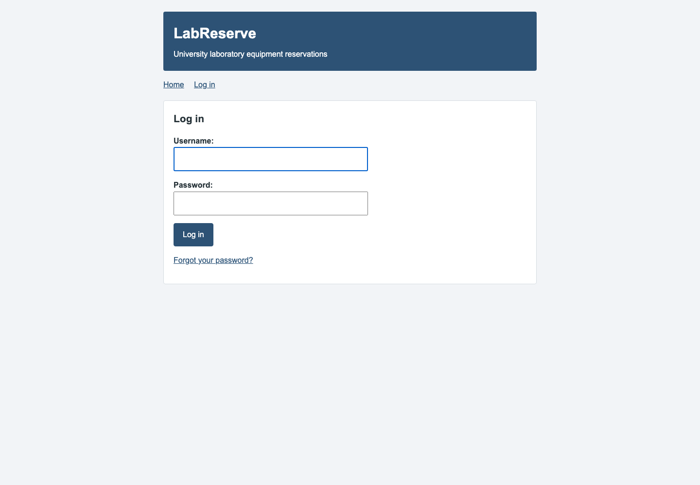
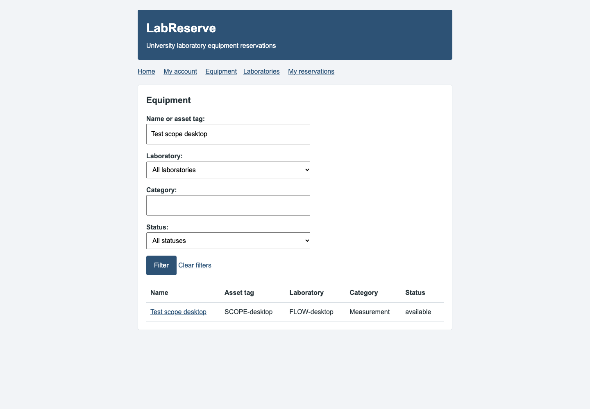
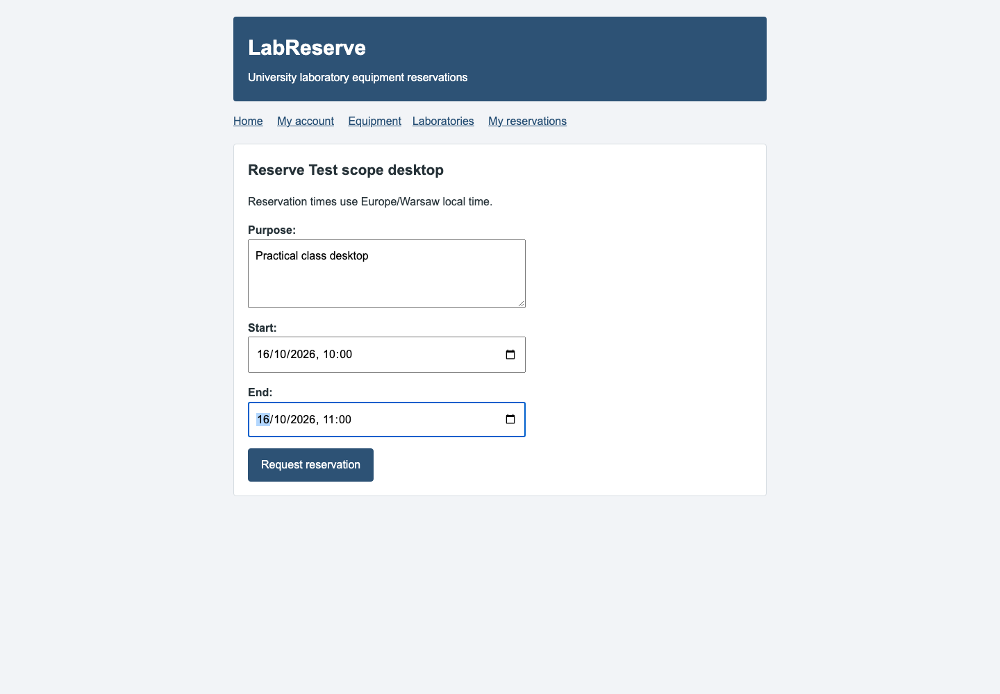
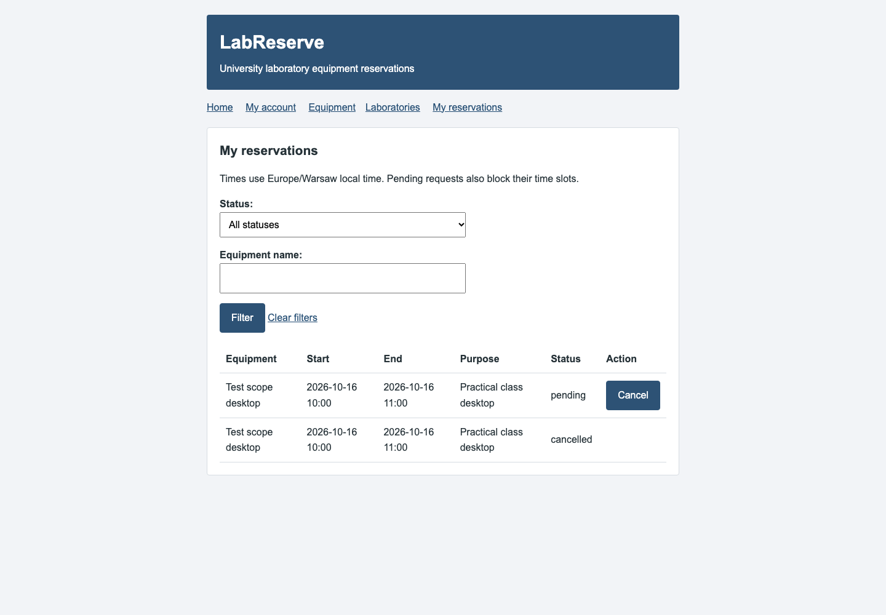
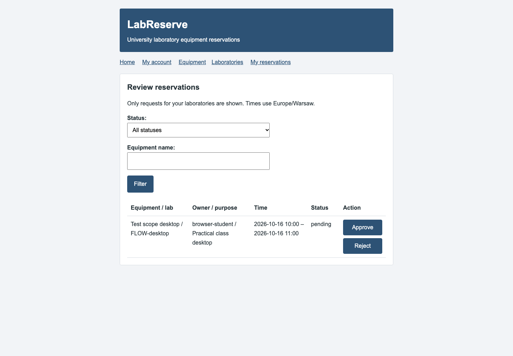
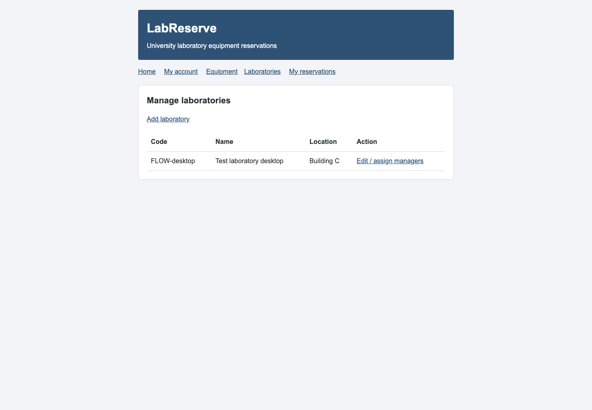
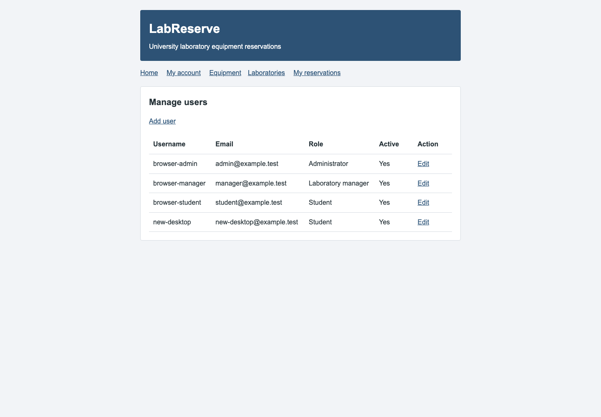
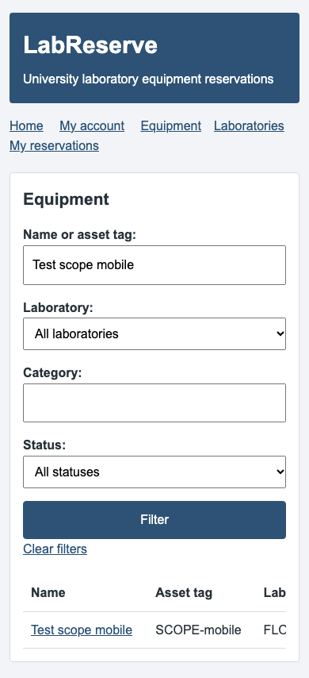

# LabReserve

A university project for booking laboratory equipment. Students need to find
equipment and reserve time without two people booking the same item at once.
Laboratory managers review requests and keep equipment availability up to date.

Uses Django, PostgreSQL and a simple HTML/CSS/JavaScript frontend.
The project idea is in [docs/proposal.md](docs/proposal.md).

Login, password reset, equipment/laboratory filters, reservations and management pages work.

## Features and roles

| Role | What the user can do |
| --- | --- |
| Student | Browse and filter laboratories/equipment, request reservations, cancel own future bookings |
| Laboratory manager | Student features, plus equipment editing and reservation approval/rejection for assigned laboratories |
| Administrator | Manage all laboratories and equipment, assign managers, create/edit/deactivate users, cancel future bookings |

Users log in with Django sessions. Forms are validated on the server and use CSRF
protection. The connection-status button uses JavaScript `fetch()` to update the
page without reloading it. Other forms use ordinary HTML submissions.

## Architecture and dataflow

The application has three Docker containers:

```text
Browser → Nginx frontend → Django backend → PostgreSQL database
```

Nginx serves HTML/CSS/JavaScript files and forwards `/accounts/`, `/workspace/`
and `/api/` requests to Django. Django renders account and booking pages, checks
permissions, and uses parameterized SQL for laboratory, equipment and reservation data.
PostgreSQL stores the data in a persistent Docker volume.

Django handles users and authentication. Laboratory, equipment and reservation
tables are defined in `backend/sql/`. Startup runs Django migrations
first, then `python manage.py apply_sql_schema`. Applied SQL filenames are recorded
in `sql_schema_versions`; add a new numbered file for future schema changes.

Each equipment item belongs to a laboratory. Each reservation links a user to an
equipment item and a start/end time. A separate table links managers to laboratories.
Users and authentication are managed by Django's user model and migrations.

For a reservation: submit form → validate fields and session → lock equipment row
→ insert a pending reservation → show it in My reservations. PostgreSQL rejects
overlapping pending/approved intervals. The assigned manager can then approve or
reject the request; the owner can cancel a future pending/approved booking.

## Run

Start Docker Desktop, then run from the project folder:

```sh
# Only copy this on first setup.
cp .env.example .env
docker compose up -d --build --wait
```

Open http://localhost:8080. Stop with `docker compose down`.
Database data is kept unless you add `-v`.

Password reset is available from the login page. In local development, emails
are printed by `docker compose logs backend`, not delivered to an inbox.
The reset link expires after one hour. For real email delivery, configure the
SMTP settings shown in `.env.example` and recreate the backend container.
Do not share backend logs containing reset links.

## Accounts

No login account is created automatically. `POSTGRES_USER` is a database user,
not an application login. After starting the containers, create accounts from
the terminal (choose a password when prompted):

```sh
docker compose exec backend python manage.py create_account student student@example.test
docker compose exec backend python manage.py create_account manager manager@example.test --role manager
docker compose exec backend python manage.py create_account administrator admin@example.test --role admin
```

Open http://localhost:8080/accounts/login/ and use the username you created
(for example, `student`) and your chosen password. Students can access their account page;
managers also get the manager area; administrators get both management areas.
There is no public registration. Use a real email address when testing SMTP delivery.
The current local setup uses HTTP; configure HTTPS and secure cookies before public deployment.

## Using the application

1. Create an administrator using the command above and log in.
2. Open My account → Administrator area. Add users and laboratories, and assign
   active managers to laboratories. No example equipment or accounts are created automatically.
3. Open My account → Laboratory manager area → Manage equipment to add equipment.
   Administrators can manage all laboratories; managers can manage only assigned laboratories.
4. As a student, open Equipment or Laboratories. Filter the lists, open an equipment
   item and request a reservation. The detail page shows occupied slots without other users' personal details.
5. Managers approve or reject pending requests in Review reservations.
   Students see their own requests under My reservations and can cancel future bookings.

Times use Europe/Warsaw. Pending and approved requests block overlapping slots;
adjacent bookings are allowed. Cancellation/rejection releases the slot but retains history.
Equipment with active reservations cannot be moved or made unavailable. Administrators
can cancel future bookings and deactivate users instead of deleting their history.

The second SQL schema file adds a PostgreSQL exclusion constraint for overlaps.
If an older database already contains conflicting active reservations, startup stops
instead of deleting them; resolve those records before applying the schema.

## Tests

Backend: `docker compose exec backend python manage.py test tests`.

For browser tests, install Node.js 22 and run:

```sh
npm ci --prefix frontend
cd frontend
npx playwright install chromium
npm test
```

From the project folder, `python3 scripts/verify-stack.py` runs all checks
in a separate temporary Docker setup.

Verification also measures backend line and branch coverage and fails below 70%
combined coverage. Reports are saved in `test-results/backend/`; open
`test-results/backend/html/index.html` for details. The same check runs in GitHub
Actions, which uploads the reports as an artifact.

Coverage includes our `accounts`, `booking`, `core` and `config` Python packages.
Generated Django migrations, test code and third-party libraries are excluded.
HTML, CSS, SQL and JavaScript are checked through integration/browser tests,
not included in the Python coverage percentage. Browser tests run at desktop
(1440px), mobile (390px) and small-mobile (320px) widths.

For just the backend coverage check on a running stack:

```sh
docker compose exec backend python -m coverage run manage.py test tests
docker compose exec backend python -m coverage report
```

Latest verified results: **83 backend tests**, **33 browser tests**, and **95.73%
combined backend line/branch coverage**. The frontend is tested through browser
flows and layout checks; this percentage does not measure frontend JavaScript.
Verification also checks a database outage/recovery and data persistence after
containers are recreated. The GitHub Actions workflow repeats the checks on push
and pull requests.

## Screenshots

These screenshots show the actual application with disposable test accounts and
sample records, not personal data. Desktop screenshots use a 1440px viewport;
the mobile example uses 390px. Tables scroll sideways on narrow screens.

### Login



### Equipment filters



### Request a reservation



### Reservation history



### Manager approval



### Administration




### Mobile view



Regenerate screenshots using `REPORT_SCREENSHOTS=1 python3 scripts/verify-stack.py`.
This uses a temporary database and does not change your normal application data.

## Deployment on another computer

On the target computer, install Git and Docker with Compose, then run:

```sh
git clone https://github.com/alekseikud/LabReserve.git
cd LabReserve
cp .env.example .env
# Edit .env: choose a new database password and a random Django secret key.
docker compose up -d --build --wait
docker compose exec backend python manage.py create_account administrator admin@example.test --role admin
```

Open `http://localhost:8080` in a browser on that computer. Check login, create a
laboratory and equipment item, then test booking and approval. Use `docker compose ps`
to confirm all three services are healthy. Node.js is needed for browser tests,
not for running the application.

The published port is bound to loopback. For private remote access, keep that
binding and use an SSH tunnel from your own computer:

```sh
ssh -L 8081:127.0.0.1:8080 user@server
```

Then open `http://localhost:8081`. For a public deployment, configure the domain,
HTTPS, secure cookies and SMTP before exposing the application. Keep `.env` out
of Git. Actual second-computer/host deployment verification is still pending a target.

## Source and submission check

Source code and commit history: [GitHub repository](https://github.com/alekseikud/LabReserve).
This README contains the idea, roles, dataflow, setup, test results and main views.
Before submission, confirm that GitHub's checks pass for the final commit and
record the actual deployment address and verification result in the section above.
